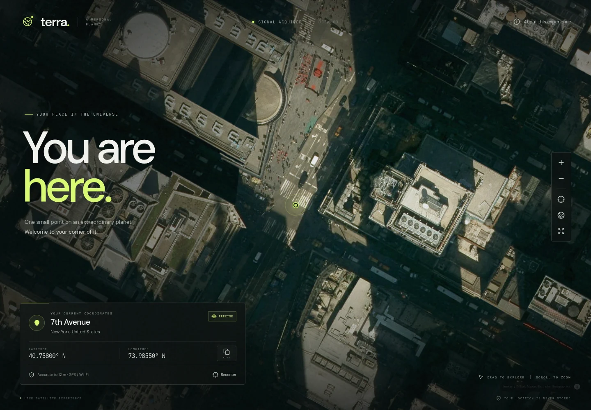

# Terra — You are here

A cinematic, responsive satellite experience that begins with the whole Earth and descends to the visitor's detected location.

**Live:** [terra.iqapps.space](https://terra.iqapps.space)



## Run locally

```sh
npm install
npm run dev
```

Open `http://localhost:5173`.

## Production

```sh
npm run build
npm run preview
```

Deploy the generated `dist/` directory to any static host. Use HTTPS in production: browsers only expose device geolocation in secure contexts (localhost is exempt for development).

## How locating works

1. **IP network location** provides an immediate approximate fix through ipwho.is, with ipapi.co as a fallback.
2. **Browser geolocation** requests a high-accuracy GPS/Wi-Fi/device fix in parallel, with the visitor's permission.
3. **OpenStreetMap Nominatim** reverse-geocodes precise coordinates into a friendly street or neighborhood name.
4. **MapLibre GL** renders Esri World Imagery and reference labels, starting in a vertical-perspective globe and descending to zoom 14.25 for network fixes or 18.25 for precise fixes.

No API keys or backend are required. Coordinates remain in memory and are not persisted by Terra. The third-party location, geocoding, font, and imagery providers receive the browser requests needed to supply their services.

## Commands

- `npm run dev` — development server
- `npm run build` — TypeScript check and production build
- `npm test` — unit tests
- `npm run preview` — serve the production build locally

## Deployment

Pushes to `main` run tests and a production build, then deploy over SSH to the VPS. The remote `terra` application user builds the site in `/srv/apps/terra`, and Nginx serves `dist/` at `terra.iqapps.space` with Certbot-managed HTTPS.

The workflow uses the same repository secret names as `javiercallico.me`: `SSH_HOST`, `SSH_USER`, `SSH_PORT`, and `SSH_KEY`. The production Nginx configuration is versioned in `ops/nginx/terra.conf`.

## Experience details

- Cinematic globe-to-street camera flight with reduced-motion support
- Responsive desktop and mobile layouts
- Interactive pan/zoom, recenter, whole-Earth reset, and fullscreen controls
- Decimal coordinate copying and accuracy/source indicators
- Graceful permission-denied, offline, and unavailable-location states
- Keyboard focus styles, semantic controls, and an accessible privacy/about dialog

Imagery attribution is displayed on the map: © Esri, Maxar, Earthstar Geographics.

## License

MIT © 2026 Javier Callico. See [LICENSE](LICENSE).
